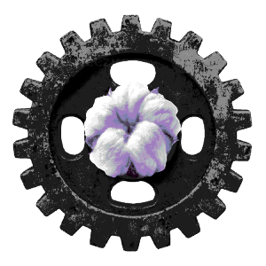

# cotton

cotton is a small stack machine for the cot programming language (a concatenative language inspired by Lua, Forth and a bit of Uxntal) written in C99

cotton is a passion hobby project being made solely by me, so, dont expect anything grandiose or of high quality - even then, suggestions and ideas are always welcome!! :D

## building cotton

```
meson setup build
ninja -C build
```

## running cotton

```
cotton <file.cot>
```

### docs

doccumentation for (cot)ton can be found inside of the `docs` folder of the repo!! make sure you have `mandoc` so you can read them.,., or just, idk, read them RAW, you do you xP

as stated in the docs, since cotton still hasn't reached a stable release + knowing how i change my mind very easily, the language might be a bit unstable for the time being and hence stuff might change quite a bit between releases, so, i'll try to keep the docs up-to-date with upmost priority so everything is properly doccumented :)

### cot's logo



this is cot's logo !! its a cogwheel with a cotton flower in the middle !! very cool !!

### (cot)ton's mascot


this is (cot)ton's mascot!! his name is ton!! he was drawn by me using old cotton's own colour palette!! say hi to ton!!

### misc

did yuo knuow,.., did.,., did yuo know that if you use void linux you can get cotton from xbps-src.., yeag,., you should totally check out ,., eyes emoji,,. ooooooo..,,
